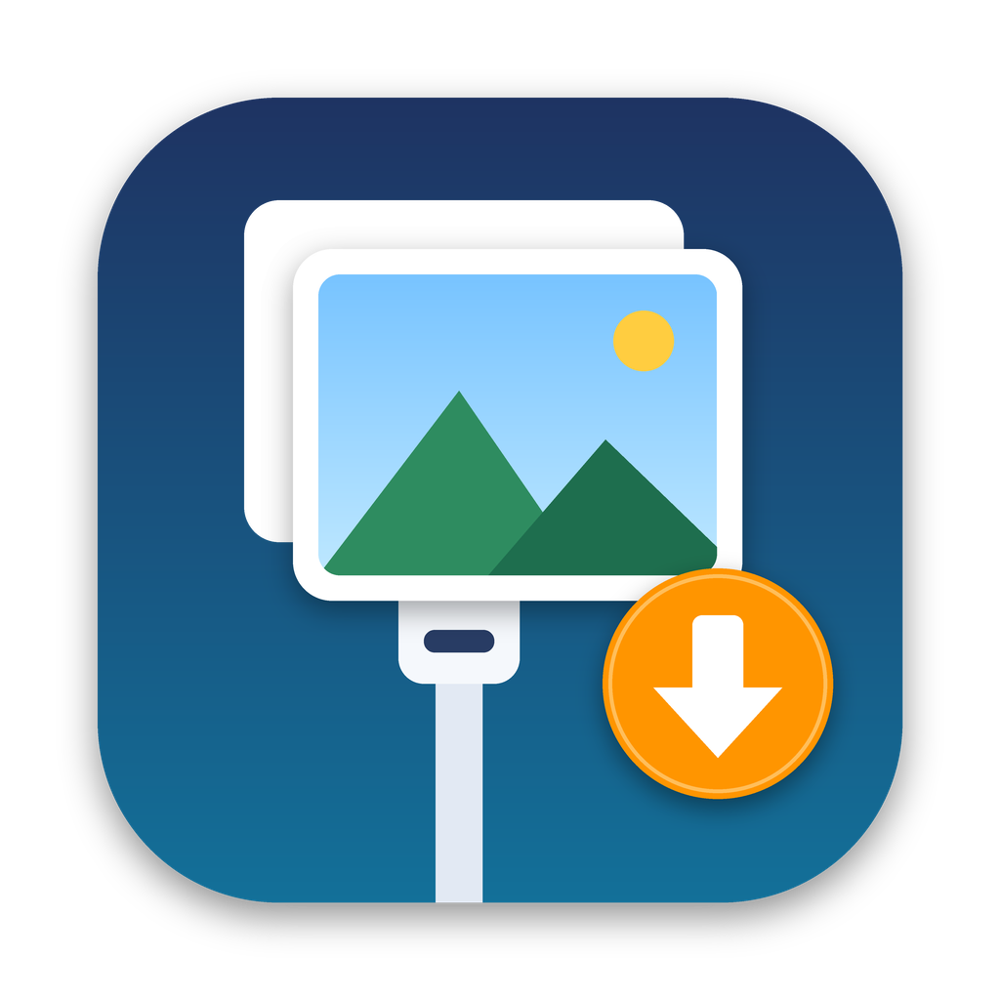

<p align="center"></p>

# USBPhotoPull

A small macOS app for copying photos and videos off an iPhone or iPad over USB into a folder you choose. Unlike Image Capture, it keeps the original dates on the copied files, handles Live Photos and edits properly, and can safely clear the phone afterwards.

## Features

- **Original dates kept.** Files are copied byte for byte, so EXIF, GPS and video metadata stay intact. Finder's *Created* date is set to the moment the photo was taken and *Modified* to the device's date.
- **Correct local time.** Date folders and date-based file names use the local time where the photo was taken, read from the file, so travel photos land on the right day.
- **Live Photos and edits.** The Live Photo `.MOV`, the `.AAE` edit file and the edited `IMG_E…` copy all come through and stay together.
- **Organizing.** Optional `YYYY/YYYY-MM-DD` folders, three file-name styles and a separate Screenshots folder.
- **Never re-imports.** Files already in the destination (same name and size) are skipped and marked in the grid.
- **Finder-style browsing.** A thumbnail grid grouped by day, with click / ⌘-click / ⇧-click selection, filters by type and date, a spacebar preview and a thumbnail cache.
- **Safe transfers.** Files download to a hidden temp folder and are moved into place only after their size is verified. A stalled transfer times out, and unplugging stops the import cleanly. The Mac stays awake during imports, and free space is checked first.
- **Delete after import, with a review step.** You see exactly what will be removed, grouped by day, and can untick anything. Only verified files are deleted, and Live Photos are always deleted whole.
- **Logs.** A CSV import log in the destination with one row per file, and a device log for connection issues.
- **Parallel downloads**, Dock progress, and a notification when an import finishes in the background.

## Requirements

- macOS 13 or later
- Xcode command-line tools (`xcode-select --install`). Xcode itself isn't needed.

## Build

```bash
./build.sh            # build for this Mac → build/USBPhotoPull.app
./build.sh install    # build and copy to /Applications
./build.sh universal  # Apple Silicon + Intel
```

GitHub Actions builds it on every push to `main` (see `.github/workflows/build.yml`), and the zipped app is available under the run's **Artifacts**. Pushing a tag like `v1.0` also attaches it to a GitHub Release.

The app is ad-hoc signed. To run it on another Mac, allow it once in **System Settings ▸ Privacy & Security ▸ Open Anyway**, or run `xattr -dr com.apple.quarantine /Applications/USBPhotoPull.app`.

## Use

1. Plug in the iPhone, unlock it, and tap **Trust** if asked.
2. Choose a destination folder (footer or **Settings**, ⌘,).
3. Select items and click **Import Selected**, or click **Import All New**.

| Selection | |
|---|---|
| Click / ⌘-click / ⇧-click | select / add or remove / range |
| Day header **Select** | the whole day |
| ⌘A · ⇧⌘A · ⇧⌘I · Esc | all · all new · invert · none |
| Space or double-click | preview (← → to step through) |
| ⌘R | reload the library |

**Tip:** on the iPhone, set **Settings ▸ Photos ▸ Transfer to Mac or PC** to **Keep Originals**. Otherwise the phone converts HEIC/HEVC to JPEG/H.264 during the transfer.

## How it works

The app uses Apple's ImageCaptureCore framework, the same one Image Capture uses, over PTP. Some iPhone behaviour it works around:

- **Partial libraries.** The first library listing after the phone connects is often incomplete. The app reconnects automatically and waits for the file count to settle.
- **Late Live Photo videos.** A new Live Photo's video isn't offered over USB for a few minutes after it's taken. The still carries a Live Photo ID in its metadata, so the app recognizes it and keeps it on the phone until the video can be imported too.
- **Duplicate file names.** `IMG_0241.HEIC` can exist from 2019 and from today. Files are matched by name, size and capture time, never by name alone.
- **Repeated listings.** The phone re-lists a file after it's edited while connected. Duplicates are collapsed, keeping the newest listing.
- **Permanent deletes.** USB deletes don't go to Recently Deleted, hence the review step.

## Where things are stored

| What | Where |
|---|---|
| Settings | `~/Library/Preferences/com.thesterk.usbphotopull.plist` |
| Thumbnail cache | `~/Library/Caches/USBPhotoPull/Thumbnails/` (clear in Settings) |
| Import log | `<destination>/USBPhotoPull Import Log.csv` |
| Device log | `~/Library/Logs/USBPhotoPull/device.log` (**Help ▸ Open Device Log**) |

## Limitations

- **Only what's on the phone.** Photos kept only in iCloud ("Optimize iPhone Storage") can't be copied, and hidden or shared albums aren't offered over USB.
- **Approximate type filters.** The Screenshots filter means PNG files, and Other images means non-camera file names and GIFs.
- **No signing.** The app isn't signed with a Developer ID or notarized.

## Project layout

```
Sources/
  USBPhotoPullApp.swift          App entry, window, Settings scene, quit handling
  ContentView.swift              Main window: devices, grid, filters, footer
  SettingsView.swift             Settings window
  PreviewView.swift              Spacebar preview (photos, video)
  DeleteReviewView.swift         Review sheet shown before deleting from the device
  DeviceManager.swift            Observable state and persisted settings
  DeviceManager+Session.swift    Device discovery, sessions, library loading
  DeviceManager+Library.swift    Grid items, filters, "already imported" state, free space
  DeviceManager+Naming.swift     Destination folders and file names
  DeviceManager+Import.swift     Import pipeline: parallel lanes, temp files, timeouts, sidecars
  DeviceManager+Delete.swift     What's safe to delete, the review step, results
  DeviceManager+Preview.swift    Preview downloads, folder picker
  DeviceManager+Delegates.swift  ImageCaptureCore delegate callbacks
  PhotoItem.swift                One file on the device
  MetadataPreserver.swift        Capture time, Live Photo ID, Finder dates
  ThumbnailCache.swift           Memory + disk thumbnail cache
  ImportLog.swift                CSV import log
  AppServices.swift              Notifications, Dock progress, device log
Icon/                            App icon (make_icon.py regenerates it)
build.sh                         Build script (swiftc, no Xcode project)
```

## License

MIT. See [LICENSE](LICENSE).
